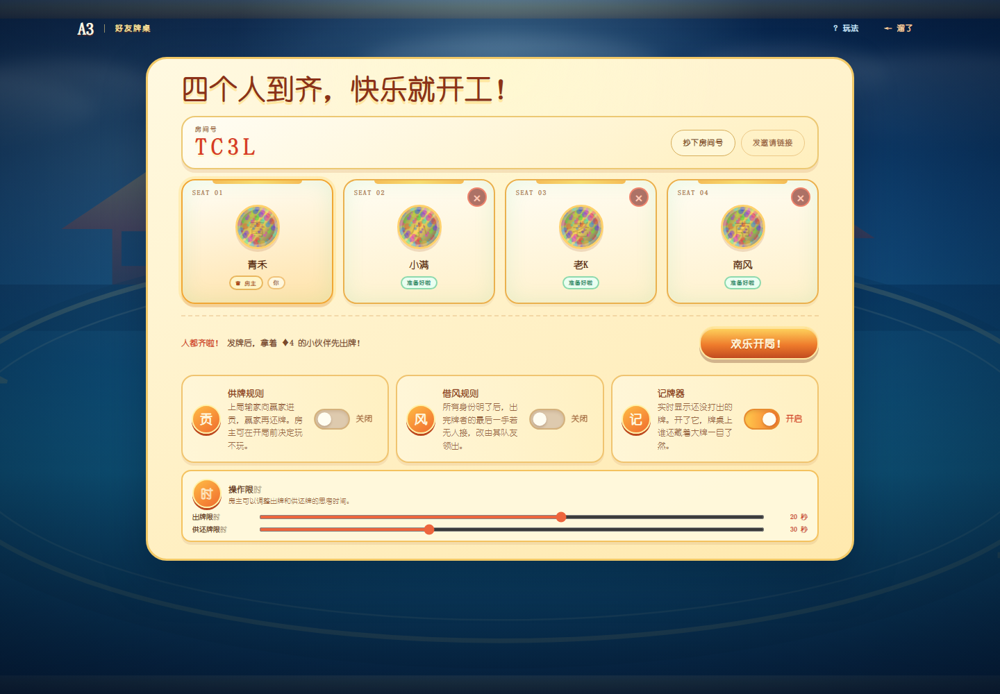
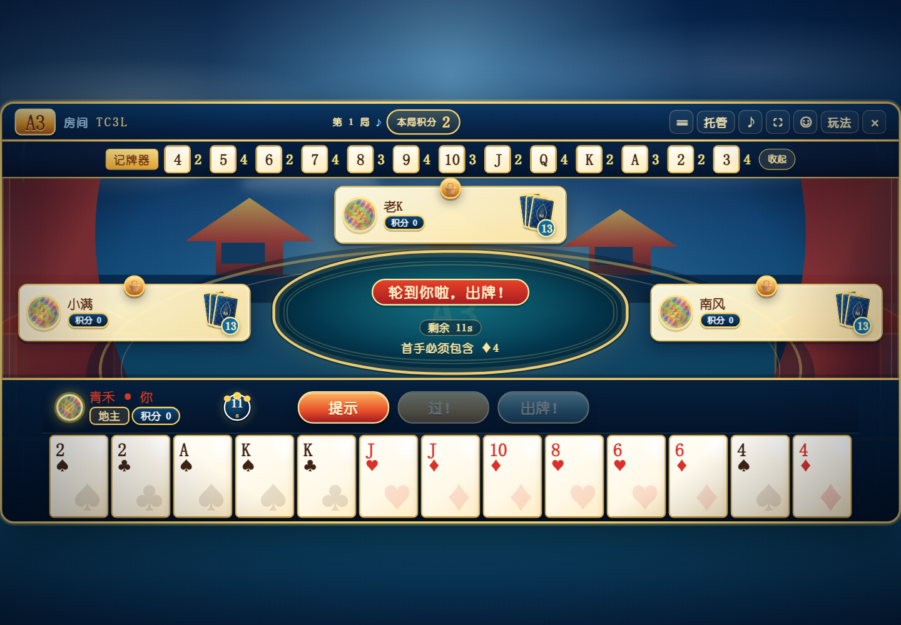
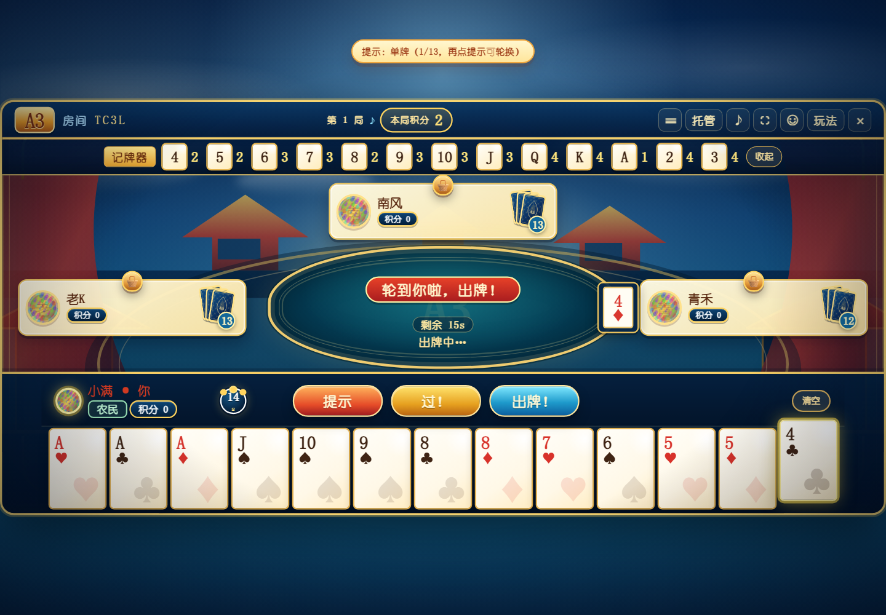
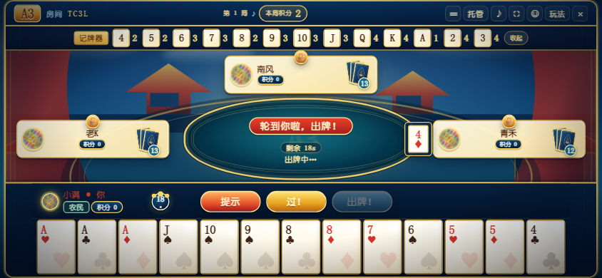
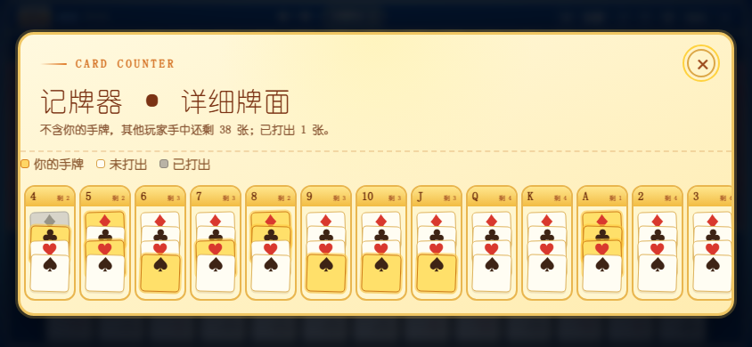
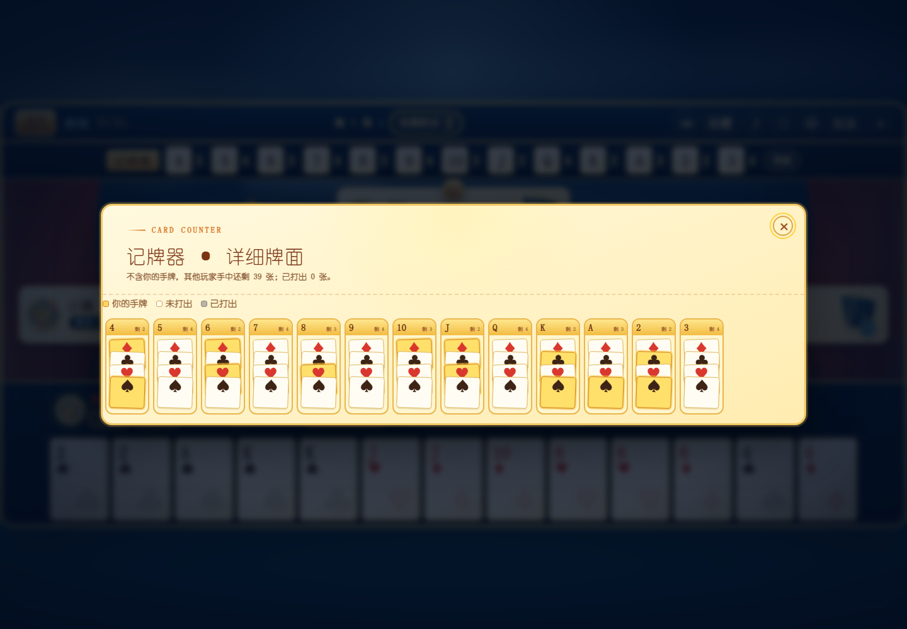
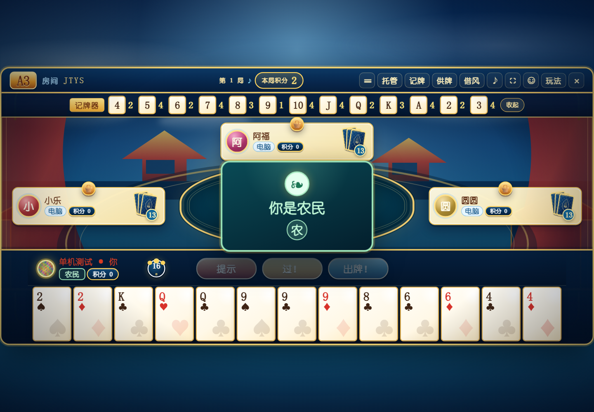
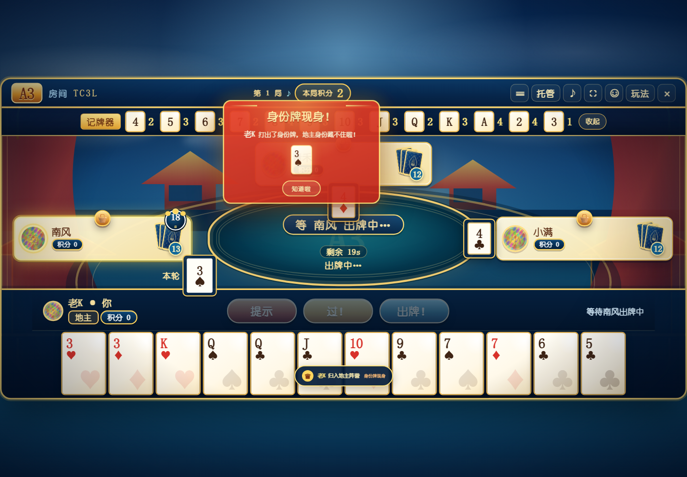
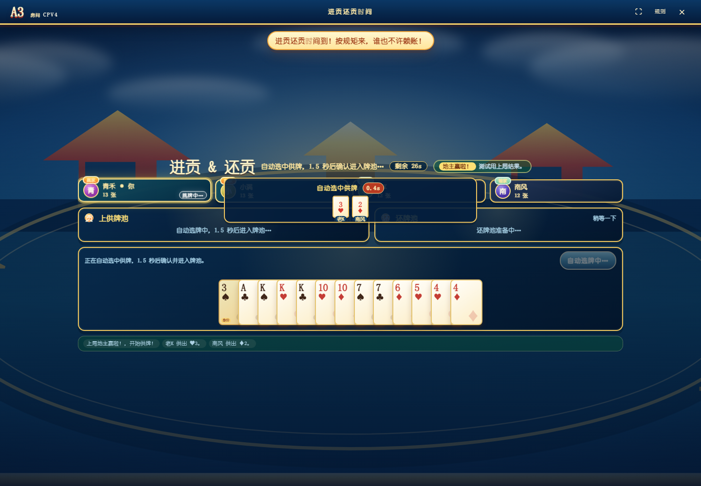

# A3 · 欢乐暗牌

一个可以直接在线联机的四人欢乐扑克牌游戏。52 张牌、每人 13 张，黑桃 A 与黑桃 3 是隐藏的身份牌。红金配色、圆角牌桌和欢乐文案，玩起来就是一桌热热闹闹的朋友局。

- 纯 Node.js 实现，没有第三方运行依赖
- 服务端权威判定：手牌、牌型、轮次、胜负都在服务端校验
- WebSocket 实时联机，断线可用本地令牌恢复座位
- 可选「供牌」规则：上局输家进贡、赢家还牌，下一局更刺激
- 可选「记牌器」与智能出牌提示，多种合法牌型可点击轮换
- 记牌器只统计其他玩家剩余牌，并支持按花色堆叠的详细牌面
- 支持单机试玩：一名玩家对阵三名电脑玩家，并可在游戏内开关记牌器和供牌规则
- 单人和多人模式都支持主动托管 / 取消托管
- 手机点全屏时会显示「复制链接到系统浏览器」的醒目提示
- 出牌 5～30 秒、供还牌 15～60 秒可调，超时自动处理
- 报单 / 报双、出完牌、身份归属、进贡还牌都有非阻塞动画
- 发牌时按「一张张发」的节奏飞到四个座位，手牌数量一张张增长
- 发牌动画结束前锁定出牌；电脑和托管也会避开这段发牌动画
- 有供牌的下一局先完成发牌动画，再进入供牌界面
- 顶栏记牌器加大到 64×40，移除顶栏身份牌条带；玩家面板内的身份提示放大
- 座位旁的本轮出牌加大；其他玩家面板用牌背 + 圆圈数字，不再写「剩 X 张 / 等待中 / 出牌中」
- 当前回合玩家面板右侧显示闹钟和剩余秒数；房主不再显示身份标记
- 默认开启多局积分：本局积分由所有玩家出牌共同累加/相乘，顶栏显示本局唯一积分；每位玩家另有个人累计积分
- 结算时每个输家支付本局积分，赢家均分奖池；结算表显示每人本局变化和当前个人积分
- 供牌/还牌页手机端无需上下或左右拖动，双地主三张供牌也能全宽展示
- 房主可在大厅/结算踢人；对局中为避免破坏牌局会提示结算后再踢
- 对局记录只显示出牌人头像和实际出的牌，字号放大，无时间戳和多余说明
- 身份弹窗手机端压缩为主要身份信息；个人面板身份只保留外框和汉字
- 供牌挑走的牌保留在牌池内灰显，并标注挑选者头像
- 结算右上角为退出房间，取消「先撤了」和「看结果」；身份牌收尾等动画完成后再弹结算
- 顶栏操作按钮单行显示；支持通用 emoji 表情、其他玩家面板菜篮子送花/砸蛋，以及上传头像（≤2MB，压缩到≤100KB）
- 表情气泡持续3s，发送后3s内不可再次发送；送花/砸蛋飞行1.5s+盛开/破碎1.5s，单人/多人通用
- 首页直接显示四个入口：开个房间、加入房间、单人模式、新手教程；加入房间才弹房间号输入层
- 供牌、借风、积分开关统一在结算页；积分开关不再出现在大厅和单机顶栏
- 教程直接进入一局完整模拟对局：♦4 先手、身份公开、9 种牌型、过牌/收轮、农民包揽前二结算
- 基础结束后可查看可选规则并选择结束或继续
- 闹钟深蓝白边，非最大化窗口强制显示
- 自己面板不显示剩余牌数，身份徽章放大；对局记录不带时间戳
- 无牌可出时 2.5～3.5 秒随机自动跳过，当事玩家看到 0.1 秒精度的私人倒计时
- 记牌器点数使用扑克牌方框、数量放在框外，并支持收起/展开
- 报单/报双改为个人面板内的金蓝卡通警示灯；其他玩家报单/报双时有语音「我就剩 X 张牌啦」；自己报单不显示警示灯
- 记牌器点数用扑克牌方框，剩余数字放在框外
- 发牌结束后弹出私人身份动画，地主/农民使用不同视觉；身份只标在自己的个人面板
- 供牌会自动选中 1.5 秒并自动确认，随后飞入牌池提供给赢家挑选
- 公开身份牌提醒带 1.5 秒倒计时，先从出牌者座位飞入，结束后再收缩回该座位消失；私人身份动画独立制作
- 每次出牌有短暂喊牌动画和中文语音：单牌报花色点数、对子报「对 X」、三条报「三条 X」、五张牌报牌型
- 出牌动画从出牌者座位飞出，再回到出牌者座位，清楚提示操作方
- 地主现身后公开地主；农民出完或两张地主牌全部现身时公开农民
- 当前一轮每位玩家的出牌显示在其座位旁的牌桌上，跳过时显示「跳过」
- 自己的本轮出牌和「跳过」固定在左下角空白区，不遮挡其他玩家面板
- 游戏内字号按参考截图设置下限，顶栏、座位、操作按钮、供牌页、对局记录、结算页、规则页和弹窗不做小字
- 对局记录、结算页和规则页使用深蓝金边主题，结果页阵营名单和顺位文字提高对比度
- 无牌可出的原因不会公开；中央不再长期堆叠上一手牌
- 自适应桌面与手机；手机全程横屏，进入首页时检测方向，竖屏只显示横屏提示；支持全屏

## 快速开始

要求 Node.js 18 或更高版本。运行服务本身只需要 Node 18；联机自动化测试使用 Node 内置的 `WebSocket` 客户端，建议使用 Node 22+。

```bash
npm start
# 或者
node server.js
```

默认监听 `0.0.0.0:3213`：

- 本机：<http://127.0.0.1:3213>
- 局域网：`http://你的局域网IP:3213`（启动日志会打印）

打开页面后：

1. 输入外号，点击「开个房间」
2. 把房间号或邀请链接发给另外三位朋友
3. 其他玩家加入并点击「我准备好啦」
4. 四人到齐，房主可以设置「供牌规则」「借风规则」「记牌器」和操作限时，然后点击「欢乐开局！」

不想等人时，可以直接点击首页的「单机试玩 · 对阵三个电脑玩家」。

局域网联机时，请确保系统防火墙允许 Node.js 接收该端口的入站连接。

### 换电脑 / 换手机 / 公网部署

详细的迁移步骤、需要拷贝的文件、Android Termux 运行方式，以及 Render 和 Docker 一键部署，请见 **[DEPLOYMENT.md](DEPLOYMENT.md)**。

如果要直接发给负责部署的人，使用这份逐步骤、零基础版：**[HANDOFF.md](HANDOFF.md)**（傻瓜式部署说明）。

> 如果对方使用 WinSCP：WinSCP 只能上传文件，不能运行 `.sh` 脚本。上传完成后仍需通过云厂商网页终端或 PowerShell SSH 执行命令，具体见 HANDOFF.md 第 5 节。

已经整理好一个最小可运行压缩包：[a3-transfer.zip](a3-transfer.zip)。

### 环境变量

```bash
PORT=8080 HOST=0.0.0.0 node server.js
```

| 变量 | 默认值 | 说明 |
| --- | --- | --- |
| `PORT` | `3213` | HTTP / WebSocket 监听端口 |
| `HOST` | `0.0.0.0` | 监听地址 |

房间保存在进程内存中。重启服务端会清空所有房间与对局；进程退出后不会恢复。

## 公网临时联机

除了部署到 VPS，也可以使用 SSH 隧道快速把本机牌桌暴露到互联网。Windows 自带的 OpenSSH 就可以：

```powershell
ssh -T -o StrictHostKeyChecking=no -R 80:127.0.0.1:3213 serveo.net
```

终端会打印一个 `https://....serveousercontent.com` 地址。第一次用浏览器打开时，会看到 Serveo 的免费隧道提示页，点击 **Continue to Site** 即可进入游戏。该地址随 SSH 进程存活，适合朋友之间临时开局；长期稳定使用建议按下一节部署到自己的服务器。

如果使用 Cloudflare Tunnel，需要确保 `api.trycloudflare.com` 可访问；当前实现自己的 WebSocket 不依赖任何第三方库。

## 公网部署

最省事的方式：

- **Render 免费 Web Service**：把仓库推到 GitHub，在 Render 里用 `render.yaml` 创建 Blueprint，平台自动构建和分配 HTTPS 域名。
- **云服务器一键 Docker**：在 Ubuntu/Debian 服务器执行 `sudo bash deploy-vps.sh`，自动安装 Docker 并启动。
- **域名 + 自动 HTTPS**：`sudo bash deploy-vps.sh a3.example.com`，自动用 Caddy 申请证书并代理 WebSocket。

完整步骤见 [DEPLOYMENT.md](DEPLOYMENT.md)。

如果需要自己配置反向代理，程序同时提供静态页面和 WebSocket，只需要代理一个 Node 端口。Nginx 示例：

```nginx
server {
    listen 80;
    server_name a3.example.com;

    location / {
        proxy_pass http://127.0.0.1:3213;
        proxy_set_header Host $host;
        proxy_set_header X-Forwarded-For $proxy_add_x_forwarded_for;
    }

    location /ws {
        proxy_pass http://127.0.0.1:3213;
        proxy_http_version 1.1;
        proxy_set_header Upgrade $http_upgrade;
        proxy_set_header Connection "upgrade";
        proxy_set_header Host $host;
        proxy_read_timeout 3600s;
    }
}
```

使用 HTTPS 时，前端会自动连接 `wss://`。公网部署建议放在 HTTPS 反向代理之后，并注意房间号只适合朋友间的轻量访问控制，不适合作为高安全要求的鉴权系统。

## 游戏规则摘要

### 牌序

点数：`4 < 5 < 6 < 7 < 8 < 9 < 10 < J < Q < K < A < 2 < 3`

花色：`♦ 方块 < ♣ 梅花 < ♥ 红心 < ♠ 黑桃`

- 每人 13 张，共 52 张
- 持有 ♦4 的玩家先出牌
- 第一手必须包含 ♦4

### 身份与阵营

- 黑桃 A 和黑桃 3 是身份牌，持有者是「地主」阵营，其余玩家是「农民」
- 两张身份牌在同一个人手上时，该玩家是「双地主」
- 玩家知道自己的手牌，但不知道队友是谁
- 身份牌按普通牌打出；打出的瞬间全场收到提醒，打出者被公开标记为地主
- 农民出完牌后会被公开标记为农民；两张身份牌都现身后，地主阵营锁定，余下玩家全部标记为农民

### 牌型

| 顺序 | 牌型 | 张数 | 同级比较 |
| --- | --- | --- | --- |
| 1 | 三条 | 3 | 三条点数 |
| 2 | 顺子 | 5 | 最大点数，再比最大牌花色 |
| 3 | 同花 | 5 | 先花色，再按点数从高到低 |
| 4 | 三带二 | 5 | 三条点数 |
| 5 | 四带一 | 5 | 四条点数 |
| 6 | 同花顺 | 5 | 最高牌点数，再比最高牌花色 |
| 7 | 皇家同花顺 | 5 | 花色 |

- 单牌只能压单牌，对子只能压对子
- 所有多张牌按上表的牌型等级比较，高等级可以压过低等级
- 顺子范围：`45678` 到 `10JQKA`，2 和 3 不参与顺子
- 五张同花色的连续牌为「同花顺」；其中 `10JQKA` 同花是「皇家同花顺」，单独列为最高牌型

### 轮次

- 跟牌必须大过上家；也可以主动选择「不出」
- 其余在场玩家全部不出后，最后出牌者重新领出，可换任意合法牌型
- 一个玩家出完后，他的最后一手仍然可以被其他人压过；若其余人都不要，则由他的下一位在场玩家领出
- 轮到你且没有任何合法牌可出时，服务端会在 3 秒后静默自动跳过；这个原因不会显示给其他玩家
- 每轮每位玩家打出的牌会显示在自己座位旁；一轮结束、重新领出后清空
- 只剩 1 张或 2 张牌时，头像旁常驻旋转警示灯；其余玩家的圆圈数字变红闪烁并播放语音

### 限时与辅助

- 房主可在大厅设置出牌限时 `5～30` 秒，默认 20 秒
- 跟牌超时自动不出；若是本轮先手，则自动打出最小合法牌
- 供还牌限时可设置 `15～60` 秒，默认 30 秒；超时自动选择
- 记牌器为可选功能，只统计其他玩家尚未打出的牌，已扣除自己的手牌
- 点击记牌器可打开详细牌面：每个点数按 ♦、♣、♥、♠ 堆叠，已打出的牌变灰，自己的手牌标金
- 「提示」按钮会根据手牌和上家牌型自动选择合法牌；多种选择时连续点击可轮换
- 单人和多人对局都可以主动开启「托管」，由服务端自动出牌 / 过牌；再次点击取消
- 首页提供「单机试玩」，一名玩家直接对阵三名电脑玩家
- 手机全程横屏：进入首页时检测方向；支持方向锁/横屏 manifest 的浏览器自动横屏，系统阻止旋转时才显示“横屏更好玩”提示；首页/房间/对局/供牌/教程/结算均在横屏一屏展示
- 规则参考页横屏显示五节入口，长牌型表在右侧内容区内部滚动并提示

### 欢乐供牌（可选）

房主可以在大厅开启「供牌规则」。开启后，上一局不是平局时，下一局发牌完先进行进贡还贡，再确定身份和先手。

- **1 个赢家（双地主）**：3 个输家各供出 1 张最高非身份牌，赢家收下 3 张后还 3 张；按供牌大小，供牌最大的输家先挑还牌，依次挑完。
- **2 个赢家**：2 个输家各供 1 张；上局最先出完的赢家先挑供牌，另一名赢家收下剩余；赢家各还 1 张，输家按照自己供牌的大小依次挑还牌。
- **3 个赢家**：唯一输家供出最大的 3 张非身份牌；赢家按上局出完顺序各挑 1 张，再各还 1 张，输家收下全部还牌。
- **上局平局**：本轮免供，直接发牌开打。

供牌不会涉及身份牌：输家不能供出身份牌，赢家也不能用身份牌还牌。交换只发生在非身份牌之间，所以每局的身份归属保持不变；但 ♦4 可能随交换移动，供牌完成后服务端会按新手牌重新确定先手。

### 借风（可选）

房主可以在大厅开启「借风规则」，也可以在结算页投票开启或关闭；默认沿用上一局，单机模式可随时切换，下一局生效。

当两张身份牌都已公开、所有身份都明了后，如果出完牌的玩家最后一手无人接牌，不再由下家领出，而由其仍在场的队友领出。队友已经出完或不存在时，回退到正常的下一位领出。

### 多局积分（默认开启）

本局积分 S 是整桌唯一数字，由所有玩家出的计分牌型共同影响；每位玩家另有个人累计积分。

- S = (2 + 加分) × 倍率。三条 +1；顺子/同花 +2；三带二/四带一 +3；同花顺最终 ×2；皇家最终 ×4。
- 两个同花顺：S=2×2×2=8；先同花顺后三条：S=(2+1)×2=6。
- 顶栏显示「本局积分 S」，随任意玩家出牌更新；个人面板显示自己的累计积分。
- 结算：每个输家向每个赢家各支付 S；同一阵营所有人变化相等，Σ变化=0；平局全 0。
- 结算表显示每人本局变化与当前个人积分；本局总积分 S 显示在顶栏，不再单独设「本局积分」模块。
- 积分规则永久开启，不再提供关闭开关。

### 新手教程

首页「新手教程」直接进入一局 21 步的完整模拟牌局，按单人模式牌桌呈现：4 名玩家、13 张起手、♦4 先手、身份公开、过牌/收轮、全部基础牌型和阵营结算。

- 基础阶段无计时、跳过和提示；电脑按脚本出牌，玩家轮次自动选中目标牌型，玩家自己点「出牌」。
- 关键节点弹出规则讲解；基础完成后顶栏只保留「可选规则」。
- 选择「继续完成对局」后停止自动选牌，出现 20 秒计时、提示和跳过，其余按单人模式进行。
- 教程结算只显示「回到首页」。

### 胜负

| 局面 | 结果 |
| --- | --- |
| 有双地主，双地主取得第 1 或第 2 顺位 | 地主胜 |
| 有双地主，双地主未进前二 | 农民胜 |
| 无双地主，同阵营取得第 1、2 顺位 | 该阵营胜 |
| 无双地主，同阵营取得第 1、3 顺位 | 该阵营胜 |
| 无双地主，双方分别取得 1、4 与 2、3 顺位 | 平局 |

对局在胜负已经确定时结束：

- 双地主如果第 1 个出完，立即地主胜；如果第 1 个出完的是农民，则第 2 个出完的人决定结果
- 无双地主时最多进行到第 3 个出完，剩余一人的顺位自然确定为第 4

## 实现说明与细则取舍

原始规则对几处比较细节没有完全展开，本实现采用以下一致约定：

1. **多张牌跨牌型压制**：单牌、对子必须同类型；三条及以上的多张牌按牌型等级比较，因此顺子可以压三条，同花顺可以压四带一。
2. **同花顺**：五张同花色的连续牌，等级在四带一和皇家同花顺之间；同牌型比较最高牌点数，若相同再比较最高牌花色。
3. **对子花色**：点数相同，比较对子中较大的那张牌的花色；仍相同再比较另一张。
4. **皇家同花顺**：`10JQKA` 同花，等级高于同花顺；同牌型时比较花色。
5. **出完牌**：出完者的最后一手仍留在桌面，其他人继续按牌型规则跟牌；全过后由出完者的下一位在场玩家领出。
6. **结算时机**：一旦胜负确定就立即结束，不要求把剩余玩家全部打完。因此双地主获胜时可能只记录第 1 或第 2 顺位。
7. **供牌顺序**：2 个赢家时按上局出完顺序挑供牌；3 个赢家时若有人尚未出完，未出完的赢家按座位顺序排在已出完者之后。
8. **供牌与身份牌**：身份牌不参与进贡，也不能用于还牌；交换只涉及非身份牌，身份归属保持发牌结果，♦4 可能移动并改变先手。
9. **本轮出牌记录**：只记录当前这一轮每位玩家的最后一手或「过」；一轮结束、重新领出时清空。
10. **身份公开时机**：农民出完立即公开；两张身份牌都现身后，所有尚未公开的农民一起公开。身份归属动画和出完动画都不会暂停服务端。
11. **限时与无牌可出**：出牌倒计时和供还牌倒计时由服务端维护。无牌可出会在 3 秒后按普通「过」处理，状态和事件都不会告诉其他玩家原因。

## 测试

### 单元与联机测试

```bash
npm test
```

包含：

- 牌序、花色、全部牌型识别与比较
- 首手 ♦4 限制
- 三家不出后的收轮
- 出完牌后继续跟牌
- 身份牌公开
- 双地主 / 无双地主的全部胜负分支
- 随机自动对局
- 四个真实 WebSocket 客户端建房、准备、发牌、断线重连、3 秒自动跳过、完整结算
- 房间设置：出牌/供还牌限时、记牌器开关、倒计时与剩余牌统计
- 记牌器按“其他玩家剩余牌”统计，详细牌面按花色堆叠
- 单机模式：一名真人加三名电脑玩家，电脑自动出牌
- 本轮出牌记录、农民身份公开、两张地主牌现身后的全员标记
- 供牌状态机：1 / 2 / 3 个赢家、平局免供、排位挑牌、还牌交换、供牌后重新开局
- 供牌联机协议：规则开关、两家赢家挑供牌、逐个还牌、自动开局、操作倒计时

### 浏览器 UI 冒烟测试

需要本机已经安装 Edge 或 Chrome，并启动一个带远程调试端口的无头浏览器：

```powershell
# 终端 1（Windows Edge 示例）
& "C:\Program Files (x86)\Microsoft\Edge\Application\msedge.exe" --headless=new --disable-gpu --remote-debugging-port=9223 --user-data-dir=.edge-profile about:blank

# 终端 2：四标签页完整牌局
npm run test:ui

# 终端 3：供牌界面专项测试（会自行启动临时服务器）
npm run test:ui:tribute
```

`test:ui` 会打开四个真实浏览器标签，自动完成整局游戏，验证出牌、提示按钮、记牌器、身份提醒、结算、规则弹窗、再来一局，并输出桌面、竖屏提示、横屏和手机记牌器截图。`test:ui:tribute` 会开启供牌、构造上局结果、走完挑供牌 / 还牌 / 收还牌的全流程，并验证新一局正常发牌。截图输出到 `screenshots/`。

## 视觉与文案

当前界面采用原创的「宫墙金顶」欢乐牌桌风格：深蓝宫墙、金顶红柱、云纹描金、厚描边立体按钮和大号扑克牌。游戏区使用 1280×600 固定逻辑画布，电脑和手机按同一套坐标整体缩放，因此按钮、牌、记牌器和座位的相对位置一致。

所有背景、牌背、纹样和界面元素均为 CSS / SVG 原创绘制，没有引用或复制任何商业游戏的美术素材、角色或商标。

## 项目结构

```
server.js                 HTTP 静态服务、房间、WebSocket 协议、自动跳过
start-a3.cmd              Windows 双击启动脚本
lib/cards.js              52 张牌、牌型识别、比较、合法出牌枚举
lib/engine.js             一局 A3 的权威状态与结算
lib/tribute.js            可选的进贡 / 还贡状态机
lib/websocket.js          无依赖的 RFC6455 WebSocket 服务端实现
public/index.html         页面、规则弹窗与供牌界面
public/styles.css         基础布局
public/happy.css          欢乐主题基础
public/palace.css         宫墙金顶主题与固定游戏画布
public/assets/            原创 SVG 宫墙背景与牌背
public/app.js             联机客户端与交互
tests/                    单元测试与四客户端联机测试
scripts/ui-smoke.js       四标签页完整牌局测试
scripts/ui-tribute-smoke.js 供牌界面专项测试
Dockerfile                Docker 镜像
docker-compose.yml        端口直连部署
docker-compose.https.yml  域名 + Caddy HTTPS 部署
Caddyfile                 Caddy 反向代理配置
deploy-vps.sh             Ubuntu/Debian 一键部署脚本
render.yaml               Render 免费 Web Service 蓝图
DEPLOYMENT.md             迁移、手机联机和公网部署指南
HANDOFF.md                给部署人的零基础分步说明
CHANGELOG.md              版本更新记录
```

服务端只向每个玩家发送自己的手牌。其他玩家的手牌只暴露张数；身份牌在被打出前不会写入公共状态。供牌阶段也只公开牌池和交换牌，不公开其他玩家的整手牌。

## 截图


















